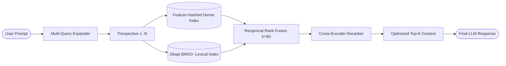

# RAG Fusion Engine

[](https://github.com/txltedxgod/rag-fusion-engine/actions)
[](https://opensource.org/licenses/MIT)
[](https://www.python.org/)
[](https://www.docker.com/)

Production-grade Retrieval-Augmented Generation (RAG) service in Python 3.11+ implementing hybrid dense/BM25+ retrieval, multi-perspective query expansion, Reciprocal Rank Fusion (RRF), and cross-encoder span reranking.

## Overview



Traditional single-query vector retrieval often misses exact identifiers or fails to capture complex intent. RAG Fusion Engine combines:
1. **Multi-query expansion** into complementary technical viewpoints.
2. **Hybrid retrieval** pairing deterministic L2-normalized word + character-trigram feature hashing with Okapi BM25+ lexical scoring and exact metadata filtering.
3. **Reciprocal Rank Fusion (RRF)** (`k=60`) across all dense and sparse ranked lists:

$$\text{RRF}(d) = \sum_{q \in Q} \frac{1}{k + \text{rank}_q(d)}$$

4. **Cross-Encoder Reranker** scoring candidate pairs on IDF-weighted query coverage, bigram/phrase match, and minimum cover-span proximity.

## Project Structure

```
├── src/
│   ├── api/v1/          # REST endpoints (CRUD documents & hybrid RAG search)
│   ├── core/            # App settings, logging, and custom exceptions
│   ├── schemas/         # Pydantic v2 data models & validation
│   ├── services/        # Dense+BM25 store, RRF engine, and CrossEncoderReranker
│   └── main.py          # FastAPI application factory & lifespan context
├── tests/
│   ├── conftest.py      # Pytest fixtures and test harnesses
│   ├── test_benchmarks.py
│   └── test_fusion.py   # Unit, retrieval, reranker, and FastAPI CRUD tests
├── Dockerfile           # Multi-stage container definition
├── Makefile             # Development automation targets
└── pyproject.toml       # Tooling configs (ruff, mypy, pytest)
```

## Quick Start

### Local Setup
```bash
# 1. Install dependencies
make install

# 2. Run linter & test suite
make lint
make test

# 3. Start development server
make run
```

### Docker
```bash
docker compose up -d --build
```

## API Reference

### 1. Ingest Document (`POST /api/v1/documents`)
```bash
curl -X POST "http://localhost:8000/api/v1/documents" \
  -H "Content-Type: application/json" \
  -d '{
    "text": "PostgreSQL 16 introduces enhanced parallel query execution for hash joins.",
    "metadata": {"category": "database", "version": "16"}
  }'
```

### 2. Inspect or Delete Document (`GET` / `DELETE /api/v1/documents/{doc_id}`)
```bash
curl "http://localhost:8000/api/v1/documents/<doc_id>"
curl -X DELETE "http://localhost:8000/api/v1/documents/<doc_id>"
```

### 3. Hybrid Multi-Query RAG Search (`POST /api/v1/search`)
```bash
curl -X POST "http://localhost:8000/api/v1/search" \
  -H "Content-Type: application/json" \
  -d '{
    "query": "PostgreSQL query performance tuning",
    "top_k": 3,
    "num_queries": 3,
    "filters": {"category": "database"},
    "rerank": true
  }'
```

## Development & Linting
```bash
make lint    # Run Ruff checks
make format  # Auto-format codebase with Ruff
make test    # Run pytest suite in tests/
```

## License
MIT
